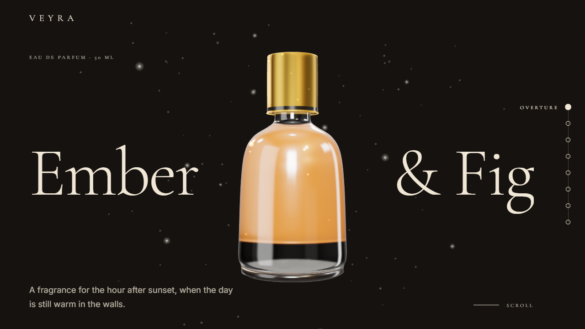
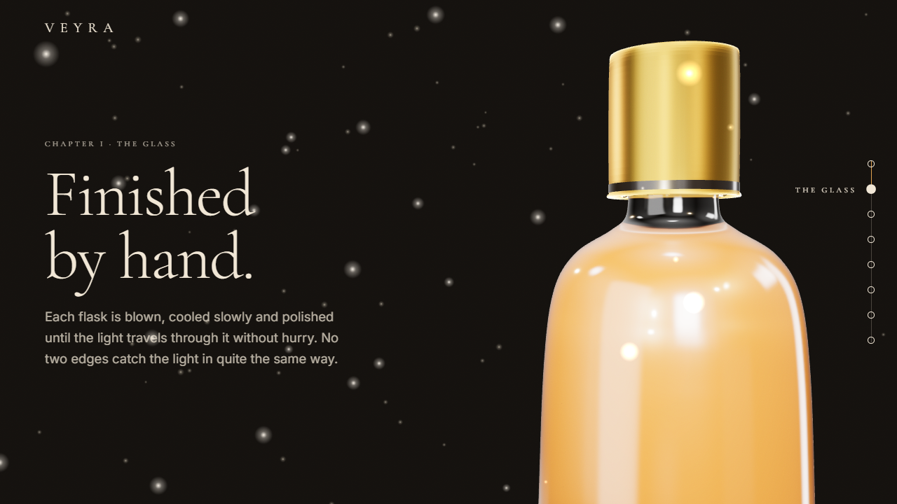
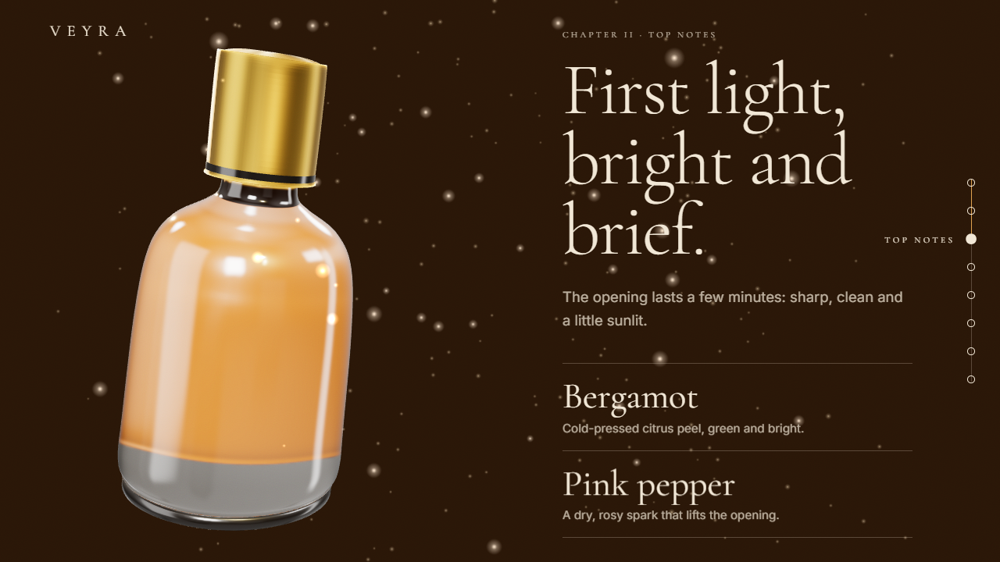
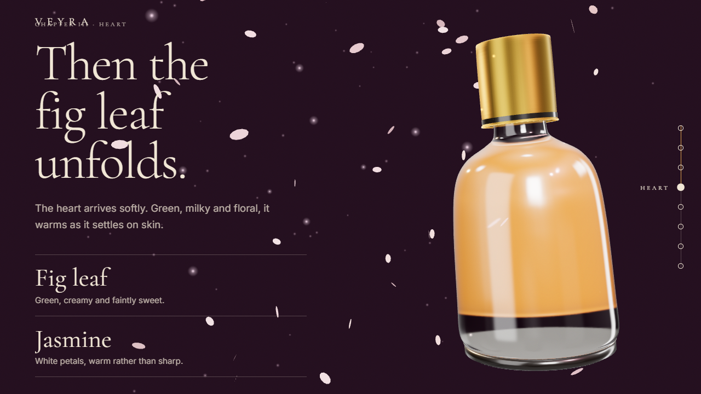
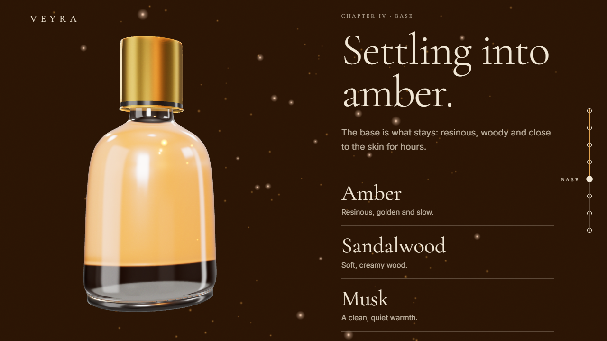
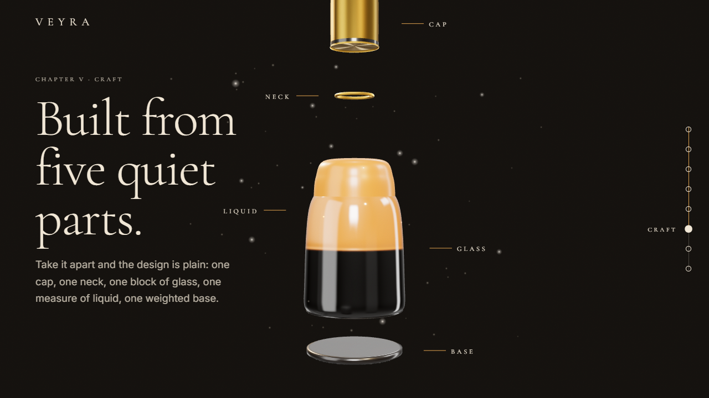
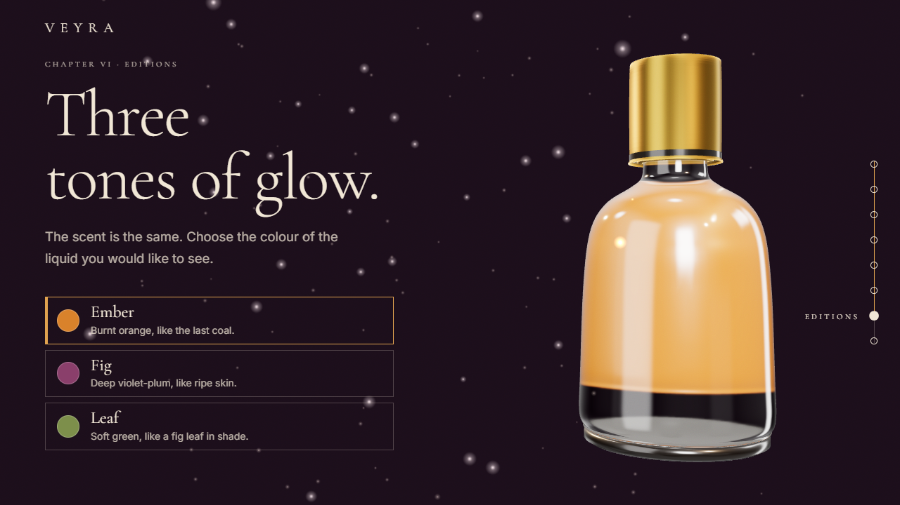
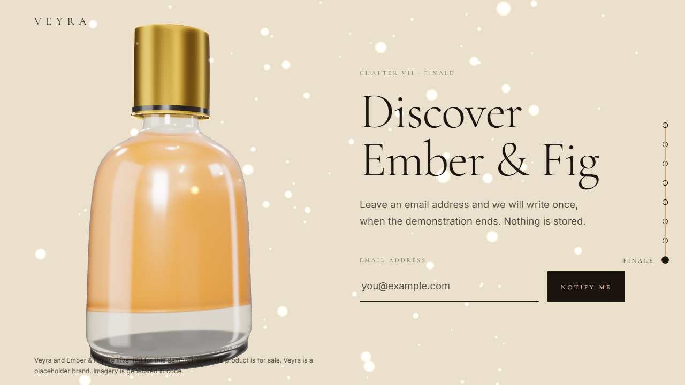

# Veyra · Ember & Fig

A scroll-story landing page for an invented luxury fragrance. One 3D bottle sits in the centre of the
screen and changes as you scroll through eight chapters. The brand, product and every word of copy are
placeholders. Nothing is for sale and no real brand is imitated.

Stack: Vite, TypeScript (strict), vanilla three.js, GSAP + ScrollTrigger, Lenis, Vitest, Playwright.
All dependencies are pinned to exact versions.

## Setup and run

```bash
npm ci            # install from the lockfile
npm run dev       # dev server (Vite picks the next free port if 5173 is busy)
npm run build     # type-check, then production build into dist/
npm run preview   # serve dist/ locally
npm run lint      # ESLint + Prettier check
npm run typecheck # tsc --noEmit
npm test          # Vitest unit tests
npm run test:e2e  # Playwright smoke test, also writes screenshots/
npm run stills    # re-capture chapter stills + OG image (run npm run build first)
```

Node 22.12 or newer is required. Docker: `docker build -t veyra . && docker run -p 8080:80 veyra`.

Add `?quality=high` to the URL to switch off adaptive quality (used by tests and screenshots), and
`?static` to preview the static fallback.

## Chapters

| #   | Chapter                  | Screenshot                               |
| --- | ------------------------ | ---------------------------------------- |
| 1   | Hero                     |          |
| 2   | The Glass                |    |
| 3   | Top notes                |      |
| 4   | Heart                    |        |
| 5   | Base                     |          |
| 6   | Craft (exploded view)    |        |
| 7   | Editions (colour picker) |  |
| 8   | Finale (notify form)     |      |

## How the scroll timeline works

1. The canvas is pinned (`position: fixed`) behind the page. Eight equal-height sections scroll over it.
2. One GSAP timeline, scrubbed by ScrollTrigger over `<main>`, tweens a single number `p` from 0 to 1.
   Lenis supplies the smooth scrolling and feeds ScrollTrigger (`src/experience.ts`).
3. `mapProgress(p)` in `src/scrollMap.ts` is a pure function that turns `p` into the whole scene state:
   bottle rotation and tilt, camera position, light colour, background colour, ink colour, liquid
   warmth, glow, exploded amount, particle mix and the sideways offset that keeps the bottle clear of
   the text. Keyframes sit at chapter centres (`p = index / 7`) and values ease between them with
   smoothstep, so the bottle comes to rest at every chapter.
4. The scene (`src/scene.ts`) applies that state each frame. Because the mapping is pure, it is unit
   tested at key values in `src/scrollMap.test.ts`.

To retime a chapter, edit the keyframes in `src/scrollMap.ts`.

## How the glass is made

- **Body**: `THREE.LatheGeometry` from a hand-written profile in `src/bottle.ts`, smoothed with a spline.
  Cap is a second lathe, the neck ring is a torus, the weighted foot is a third lathe.
- **Glass**: `MeshPhysicalMaterial` with `transmission: 1`, `thickness`, `ior: 1.5`, `roughness` near
  0.02 and a clearcoat (`src/bottleMesh.ts`).
- **Liquid**: an inner lathe mesh with its own colour and a slight emissive glow. It is opaque, so the
  transmissive glass in front refracts it.
- **Reflections**: `RoomEnvironment` through `PMREMGenerator`, with two soft-box panels added to the
  environment scene so the glass gets long, clean highlights. A warm key light, a gold rim light from
  behind, and a travelling point light give the light sweep in chapter 2.
- **Particles**: instanced meshes for dust, sparkles and petals (`src/particles.ts`).
- **Slow devices**: a "simple" glass (no transmission pass) is used on slow phones, and the scene drops
  to it automatically if frames stay slow after warm-up.

## Performance notes

- Pixel ratio is capped at 2 (1.25 on phones), with fewer particles and lathe segments on phones.
- Rendering pauses when the tab is hidden or the canvas is offscreen. Geometries, materials, textures,
  the environment target and the renderer are disposed on cleanup.
- The 3D code is a lazy chunk (`experience`), about 190 kB gzipped, mostly three.js. The entry bundle,
  CSS and fonts are small, and users who get the static version never download three.js.
- Fonts are self-hosted WOFF2 with `font-display: swap`. Images carry width/height to avoid layout shift.

## Accessibility notes

- One `h1`, then an `h2` per chapter. Every chapter is a labelled section and all copy is real text.
- The canvas is `aria-hidden`. The five craft parts are also listed as real text (hidden visually only
  while the 3D labels are showing).
- Visible focus ring, skip link, and a side chapter indicator that is a list of links
  (`aria-current="step"`). PageUp and PageDown step between chapters.
- The editions picker is a native radio group. The form has a label, `aria-invalid` and a live region.
- Ink colour follows the background brightness so text keeps its contrast through the colour changes.
- `prefers-reduced-motion`: no smooth scroll, no 3D, no parallax. Each chapter shows a static still with a
  simple fade. The same static version is shown when WebGL is unavailable or fails to start.

## Reskin for a client

All brand content lives in two files. Copy and edit them:

1. `src/content.ts`: brand name, product name, title and description (also injected into the page's
   `<title>`, description and Open Graph tags at build time), chapter text and notes, page palette,
   edition names and liquid/accent colours, craft part labels, form copy.
2. `src/bottle.ts`: the bottle silhouette (profile points), cap, foot, explode distances.

Then run `npm run build && npm run stills` to regenerate the chapter stills and the OG image, and
update `brand.url` in `content.ts` with the real site address.

## Assets and credits

See [CREDITS.md](CREDITS.md). No third-party images are used: stills are captured from the procedural
3D bottle, grain is a generated SVG, fonts are OFL. I searched for a freely licensed real 3D perfume
bottle (Poly Haven, Poly Pizza) and found nothing of suitable quality, so the bottle stays code-built.

## Limitations

- Chapters must share one height (`100svh`) for the progress mapping to line up. On very short
  windows the text can overflow its section.
- The static stills are captured from one viewport size and shown scaled.
- Software-rendered WebGL (headless CI) is slow, so tests wait generously.
- The testimonial block was not built: there is no real feedback to quote.
- The form never sends or stores anything, by design.
- A Lighthouse run was not part of this build, so the 90+ targets are unverified.
